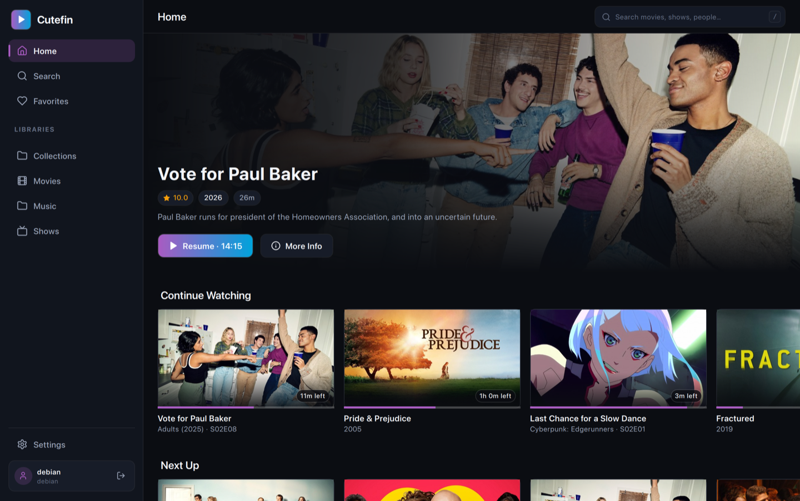
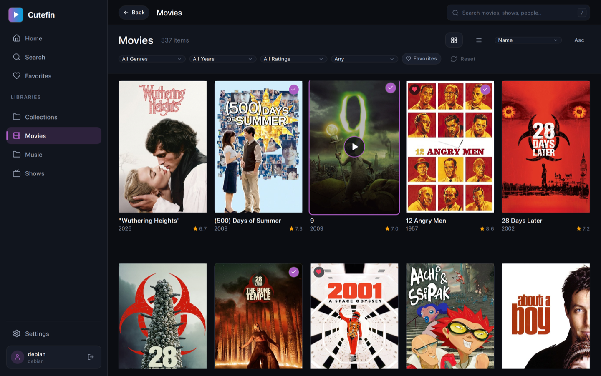
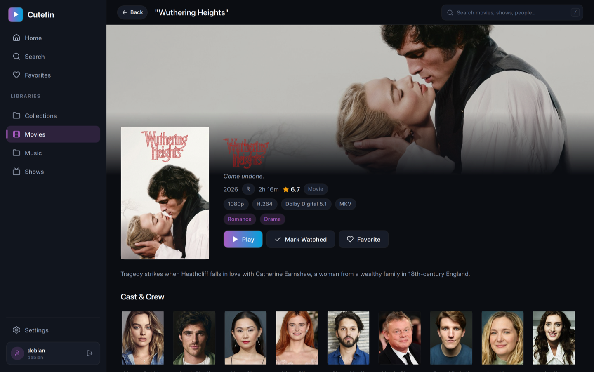
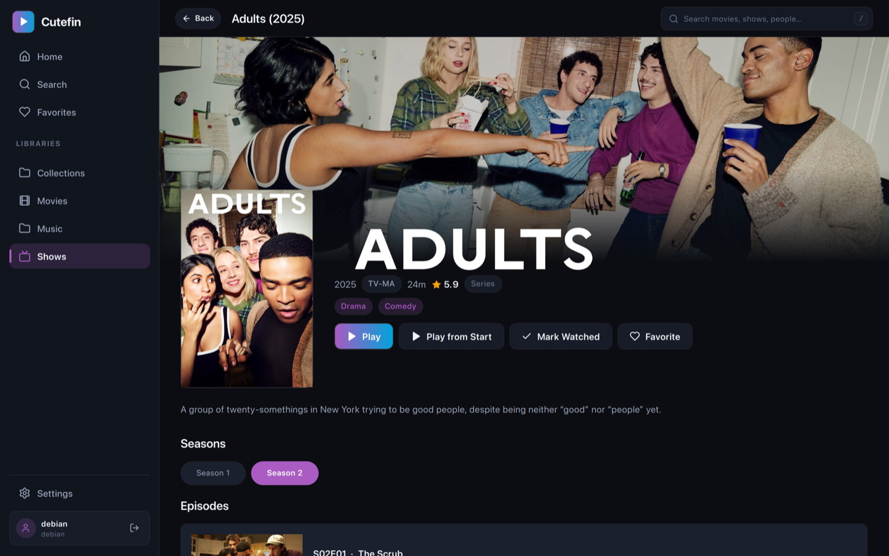
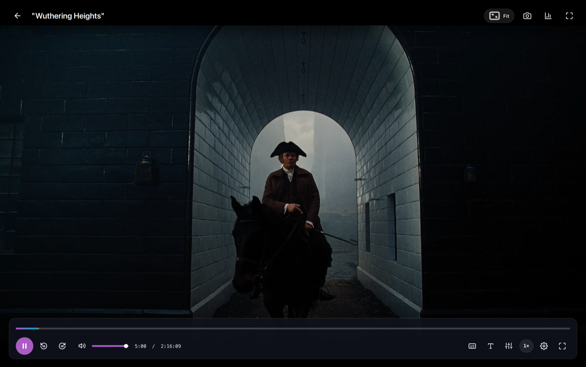
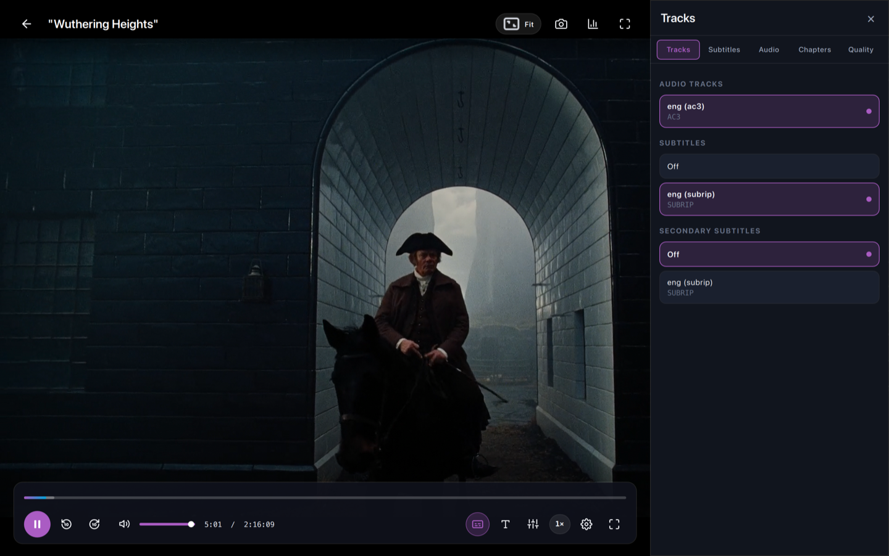
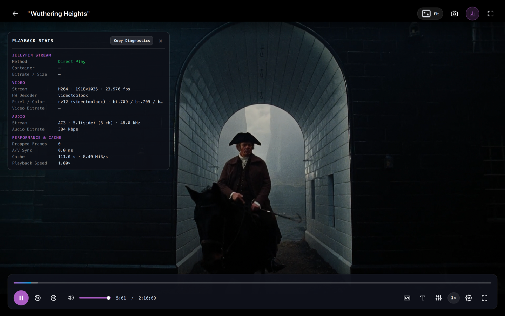
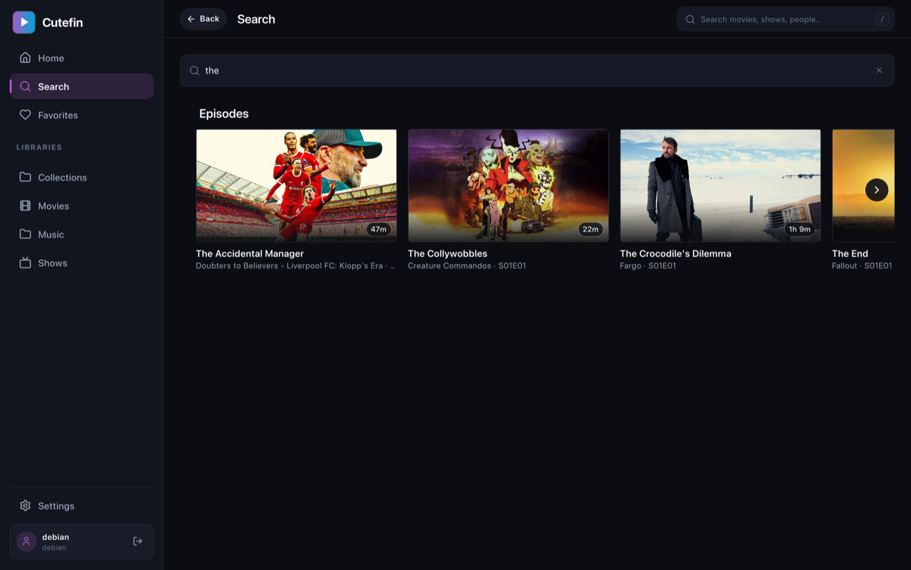
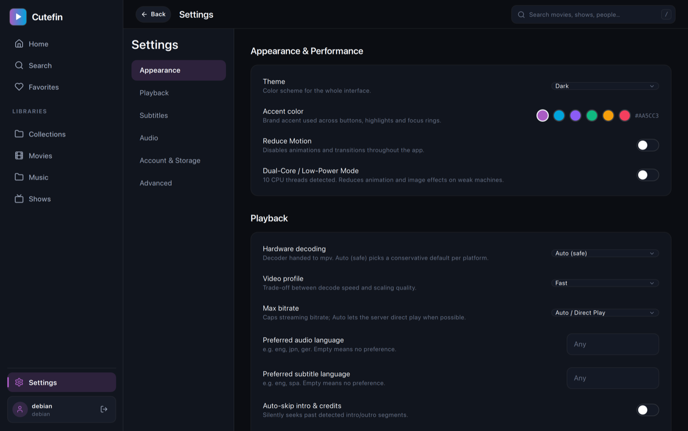

# Cutefin

A fast, modern, multiplatform **Qt 6 Quick (QML) + C++17** Jellyfin desktop client with a **single-window embedded `libmpv` player**, engineered to look web-grade while running effortlessly on **dual-core systems**.

No Electron. No Chromium. No external player windows.

---

## Screenshots

### Home — Hero Spotlight, Continue Watching & Next Up


### Library — Virtualized Poster Grid, Sort & Filters


### Media Detail — Movies & TV Series



### Single-Window Embedded `libmpv` Player


### Slide-Over Tracks / Subtitles / Audio Drawer & Live Stats Overlay



### Search & In-App Settings (Dual-Core Mode & Live Subtitle Preview)



---

## Highlights

- **Single-Window Embedded `libmpv` Player** — Video renders directly inside the Qt Quick OpenGL scene graph (`QQuickFramebufferObject` + `MPV_RENDER_API_TYPE_OPENGL`) with hardware decoding (`VideoToolbox`, `VA-API`, `NVDEC`, `D3D11VA`) and zero external windows.
- **Built for Dual-Core & Low-Power Machines**:
  - Native C++17 + AOT-compiled QML (`qt_add_qml_module`) — **0.2% idle CPU** and zero WebEngine overhead.
  - Lazy-loaded `PlayerView` (`libmpv` and its OpenGL FBO are only allocated while playing; browse shell hides during playback).
  - Zero expensive per-frame Gaussian blur shaders; instant `16×16` GPU-upscaled BlurHash placeholders.
  - Thread-safe, atomic `QSaveFile` LRU `ImageCache` with a `LowPriority` decode pool capped at `≤ 2` threads, LIFO visible-first image scheduling, in-flight deduplication, and DPR-bucketed server-side image downscaling.
  - Auto-detected **Dual-Core / Low-Power Mode** (`--profile=fast`, capped trickplay sheets & image RAM, reduced motion).
- **Rich Jellyfin Features**:
  - Password login & **Quick Connect** (6-digit code polling), recent servers, persistent sessions.
  - Home hero spotlight, Continue Watching, Next Up, Latest per library, Collections, Person filmographies, debounced Search.
  - Direct Play by default with max-bitrate transcode ladder, chapter notches + **Trickplay** hover scrubbing, primary + secondary subtitles, external Jellyfin subtitles (`sub-add`), remembered per-series track selection, live subtitle styling & audio delay/device/passthrough/normalization controls, Skip Intro/Credits, Next Episode countdown, 2 Hz Stats & Diagnostics overlay (`I` / `Ctrl+Shift+D`) with redacted tokens, and cross-platform sleep inhibition.
- **Modern Jellyfin-Inspired UI** — Deep Cinema Dark default palette (plus Light/System modes and accent color picker), crisp monochrome SVG icon set, full keyboard navigation (`/` search, `Esc` back, `Space`/`K`, `J`/`L`, `←/→`, `F`, `M`, `I`, `[`/`]`, `Z`/`X`).

---

## Building

### Dependencies
- CMake ≥ 3.21, Ninja, C++17 compiler
- Qt 6 (≥ 6.5): `Core`, `Gui`, `Network`, `Concurrent`, `Qml`, `Quick`, `QuickControls2`, `OpenGL`, `Svg`, `Test` (optional `DBus` on Linux)
- `libmpv` (`mpv` development headers + library)

### macOS (Homebrew)
```sh
brew install qt mpv cmake ninja
cmake -S . -B build -G Ninja -DCMAKE_PREFIX_PATH=/opt/homebrew/opt/qt
cmake --build build
./build/cutefin
```

### Linux
```sh
cmake -S . -B build -G Ninja
cmake --build build
./build/cutefin
```
*(On X11, Cutefin automatically sets `QT_XCB_GL_INTEGRATION=xcb_egl` unless overridden so `libmpv` VA-API EGL interop works smoothly.)*

### Tests
```sh
# Offline unit test suite (8 targets, no network required)
ctest --test-dir build -LE live --output-on-failure

# Opt-in live Jellyfin server integration test
CUTEFIN_TEST_SERVER="https://your-jellyfin-host" \
CUTEFIN_TEST_USER="username" \
CUTEFIN_TEST_PASS="password" \
  ./build/tests/tst_live
```

## Security Note
When **Remember me** is checked, the Jellyfin access token is stored in your platform's `QSettings` backend (`plist` on macOS, `.conf`/`.ini` on Linux/Windows), matching official Jellyfin desktop clients. Unchecking **Remember me** keeps the token in memory only.
